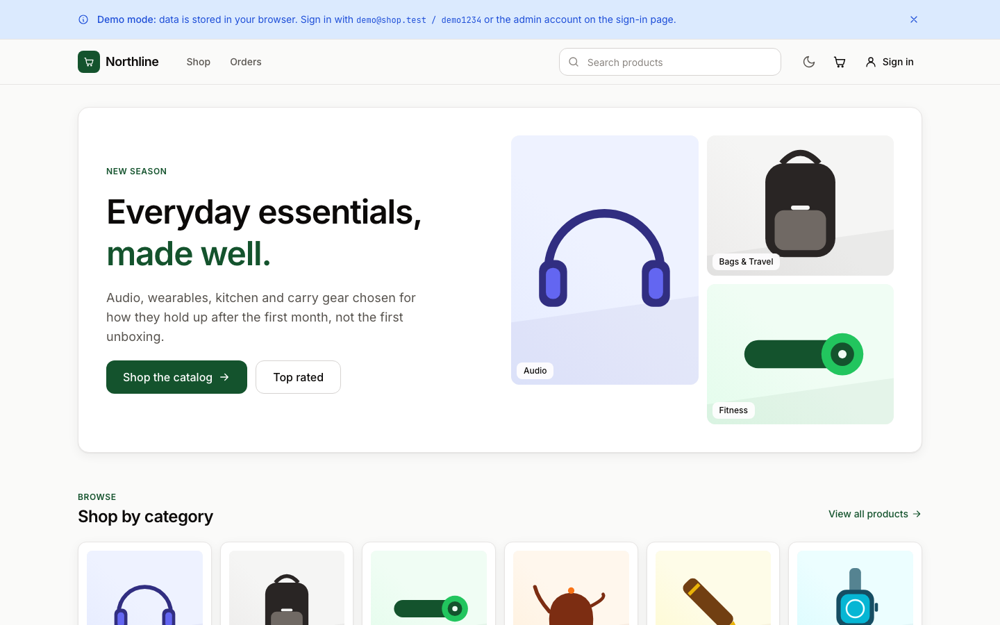

# Northline — full-stack e-commerce

An Express + MongoDB API with JWT auth, products, cart, orders and an admin role, and a React
storefront that runs against that API or entirely in the browser through a demo adapter.

**Live demo:** https://avinash9694.github.io/Ecommerce-APP/ (demo mode — data lives in your browser)



Demo accounts: `demo@shop.test / demo1234` (shopper) · `admin@shop.test / admin1234` (admin).

## Why I built this

This repo started as a bare register/login API. I rebuilt it into the kind of shop I would be
comfortable handing to a team: typed request validation, a single error shape, stock that is
reserved at order time and released on cancellation, and a storefront whose data layer is an
interface with two implementations, so the same UI is demoable on GitHub Pages without a server
and still talks to the real API locally. The optimistic cart, URL-synced catalog filters and
status-transition rules are the parts of e-commerce I have seen go wrong most often in real work.

## Features

- **Catalog** — pagination, debounced search across name/description/tags, category and price
  filters (sidebar on desktop, bottom sheet on mobile), five sort orders, all synced to the URL.
- **Product pages** — gallery, quantity stepper capped at stock, related products, tags.
- **Cart** — drawer and full page, optimistic add/update/remove with rollback on failure, free
  shipping threshold, server-enforced stock limits.
- **Checkout** — validated shipping form, order reserved with stock decrement, then a mock card
  payment step; an order left unpaid can be paid later from its detail page.
- **Orders** — list and detail with a status timeline (placed → paid → shipped → delivered, or
  cancelled with refund and stock release).
- **Auth** — register/login with correct status codes (`401` for bad credentials, `409` for a
  taken email, `400` with field details), JWT expiry, rate limiting on auth routes.
- **Admin** — products table with create/edit/delete, orders table with constrained status
  transitions. Visible only to the `admin` role.
- **Demo mode** — the whole catalog, cart, orders and accounts persisted to `localStorage` with
  simulated latency; dismissible banner; one-click demo sign-in; reset from the account page.
- Light-first theme with dark mode (follows the system, toggle persisted), responsive from 360px,
  keyboard-reachable dialogs with focus trapping, `aria-live` status regions, skeletons and
  empty/error states on every async path.

## Architecture

```
                         ┌──────────────────────────────┐
                         │          React app           │
                         │  pages → TanStack Query hooks│
                         │        → ApiClient (interface)│
                         └──────────────┬───────────────┘
                 VITE_API_URL set?      │
              ┌─────────── yes ─────────┴────────── no ───────────┐
              ▼                                                   ▼
   ┌─────────────────────┐                             ┌─────────────────────┐
   │   HttpApiClient     │  fetch + Bearer JWT         │   DemoApiClient     │
   │   /api/v1/*         │ ──────────────┐             │ same contract, same │
   └─────────────────────┘               │             │ error codes, state  │
                                         ▼             │ in localStorage     │
                       ┌──────────────────────────┐    └─────────────────────┘
                       │ Express 4 + Mongoose 8   │
                       │ zod validation · helmet  │
                       │ cors allowlist · limiter │
                       └────────────┬─────────────┘
                                    ▼
                               MongoDB 7
```

`client/src/api/index.ts` is the only module that knows which adapter is active; everything
else imports `api` and `isDemoMode` from it. Both adapters share `client/src/api/types.ts`
(the `ApiClient` contract, domain types and `ApiError`) and the seed catalog in
`server/src/seed/catalog.json`, so the demo shows exactly what `npm run seed` loads.

Money is stored as integers in minor units (paise) end to end; `computeTotals` is mirrored in
`server/src/utils/pricing.js` and `client/src/lib/pricing.ts` and tested on both sides.

## Tech stack

- **Server:** Node 20+, Express 4, Mongoose 8, Zod, jsonwebtoken, bcryptjs, helmet, cors,
  express-rate-limit. Tests with Vitest, supertest and mongodb-memory-server.
- **Client:** Vite 6, React 18, TypeScript (strict), Tailwind CSS v4, TanStack Query 5,
  Zustand, react-router (HashRouter), Zod. Tests with Vitest + Testing Library.
- **Tooling:** npm workspaces, ESLint 9 flat config (typescript-eslint, react-hooks, jsx-a11y),
  Prettier, GitHub Actions → GitHub Pages, Docker Compose for the full stack.

## Running locally

```bash
npm install                 # installs both workspaces

# Demo mode (no server needed)
npm run dev -w client       # http://localhost:5173

# Full stack with Docker (MongoDB + API on :8080)
docker compose up -d
docker compose run --rm seed            # 6 categories, 24 products, demo + admin accounts
echo "VITE_API_URL=http://localhost:8080" > client/.env.local
npm run dev -w client

# Or run the API on the host against your own MongoDB
cp server/.env.example server/.env      # set MONGO_URI, JWT_SECRET, CORS_ORIGINS
npm run seed
npm run dev                             # server (:8080) and client (:5173) together
```

Environment variables are documented in [`server/.env.example`](server/.env.example) and
[`client/.env.example`](client/.env.example).

## API

Hand-written OpenAPI 3.1 reference: [`server/openapi.yaml`](server/openapi.yaml). All routes
live under `/api/v1`; errors are always `{ "error": { "code", "message", "details?" } }`.

| Area       | Endpoints                                                                                                 |
| ---------- | --------------------------------------------------------------------------------------------------------- |
| Health     | `GET /health`                                                                                             |
| Auth       | `POST /auth/register` · `POST /auth/login` · `GET/PATCH /auth/me`                                         |
| Categories | `GET /categories` · `GET /categories/:slug` · admin `POST` / `PATCH /:id` / `DELETE /:id`                 |
| Products   | `GET /products` (page, limit, q, category, tag, min/maxPrice, featured, sort) · `GET /:slug` · admin CRUD |
| Cart       | `GET /cart` · `POST /cart/items` · `PATCH/DELETE /cart/items/:productId` · `DELETE /cart`                 |
| Orders     | `POST /orders` · `GET /orders/mine` · `GET /orders/mine/:id` · `POST …/pay` · `POST …/cancel`             |
| Admin      | `GET /orders` · `PATCH /orders/:id/status`                                                                |

## Testing

```bash
npm test                    # server (70 tests) then client (63 tests)
npm run lint && npm run typecheck && npm run build
```

- **Server (Vitest + supertest + mongodb-memory-server):** auth status codes and token
  handling, product list filters/sort/pagination, category rules, cart math and stock limits,
  order placement including insufficient stock with reservation rollback, payment and
  cancellation, admin authorisation and status transitions, CORS allowlist, error shapes.
- **Client (Vitest + Testing Library):** pricing and money formatting, catalog URL param
  parsing/serialising, optimistic cart transitions, the demo adapter (persistence, auth, stock,
  orders, admin), checkout and auth schemas, product form validation, and a render smoke test
  for every page.

## Project structure

```
server/
  src/
    app.js            Express app factory (helmet, cors, routes, error handler)
    index.js          Entrypoint with graceful shutdown
    config/           env + db
    middleware/       auth (JWT, admin), validate (zod), rate limit, error handler
    models/           User, Category, Product, Cart, Order
    schemas/          zod request schemas
    controllers/      route handlers
    routes/           /api/v1 routers
    seed/             catalog.json + seed script
  test/               Vitest suites
  openapi.yaml
client/
  src/
    api/              types (ApiClient contract), http-client, demo/ (adapter + store), index
    features/         auth, products, categories, cart, orders, checkout (hooks + schemas)
    components/       ui kit, layout, product, cart, orders
    pages/            one file per route, admin/ sub-pages
    lib/              pricing, money, catalog-params, storage, dates
    hooks/, store/, routes/, test/
  public/products/    generated SVG artwork (client/scripts/generate-product-art.mjs)
docker-compose.yml    mongo + server (+ seed profile)
.github/workflows/    lint, typecheck, test, build and deploy the client to Pages
```

## Roadmap and known limitations

- Payments are mocked on purpose; wiring Razorpay or Stripe would replace `POST /orders/:id/pay`.
- Guest carts are not supported: adding to the cart prompts a sign-in. A local guest cart merged
  at login is the obvious next step.
- Product images are generated placeholder SVGs so nothing dead-links; a real catalog would use
  object storage.
- Stock reservation is a sequence of conditional updates with compensation rather than a MongoDB
  transaction, so it works on a standalone `mongod` (and in tests); a replica set would allow a
  real transaction.
- Demo mode stores a lightweight hash of demo passwords in `localStorage`; it is a convenience,
  not a security boundary.

## License

[MIT](LICENSE)
